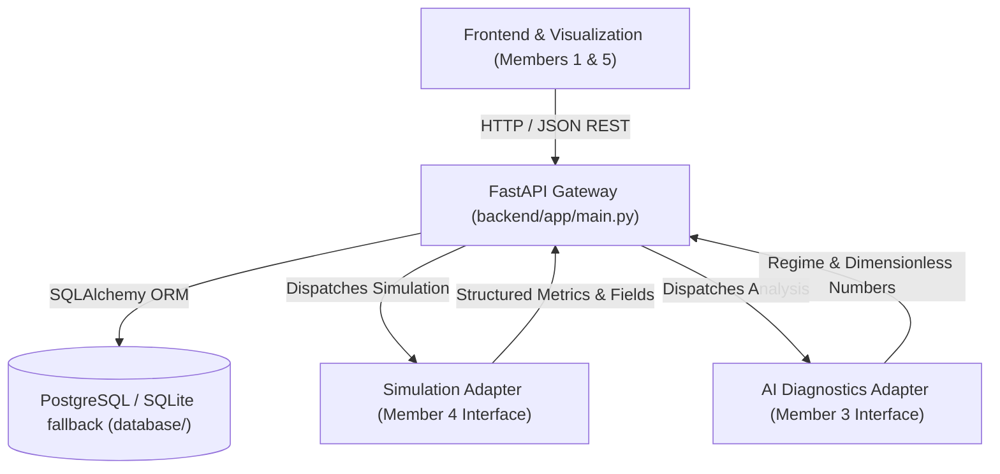

# NASA-FLAME: Backend Architecture & API Specifications

**NASA-FLAME – Flame in Freefall**  
Backend & API Architecture (Member 2 Ownership: `backend/`, `database/`)

---

## 1. Architectural Overview

The backend acts as the central orchestrator and data hub for NASA-FLAME, bridging:
- **Frontend / UI**: Reactive dashboard, 3D/2D visualization controls, and experiment managers.
- **Simulation Engine (Member 4)**: Numerical combustion solvers executing variable-gravity flame models.
- **AI Engine (Member 3)**: Microgravity combustion diagnostics, regime classification, and dimensionless scaling analysis.
- **Database (`database/`)**: Relational storage for experiments, simulation scalar fields, time series, and AI reports.



---

## 2. Technology Stack

- **Framework**: FastAPI (asynchronous, high performance, auto OpenAPI/Swagger)
- **Validation & Schemas**: Pydantic v2
- **Database ORM**: SQLAlchemy 2.0
- **Database Engine**: PostgreSQL (production) with seamless SQLite fallback (development)
- **Migrations**: Alembic
- **Testing**: Pytest & HTTPX TestClient

---

## 3. Quick Start (Windows Development)

### 3.1 Setup Environment

```powershell
# In project root (C:\Users\Srujan S\NASA-FLAME)
python -m venv .venv
.\.venv\Scripts\activate

# Install backend dependencies
pip install -r backend/requirements.txt
```

### 3.2 Seed Reference Experiments (Optional)

```powershell
python database/seeds/seed_experiments.py
```

### 3.3 Launch Backend Server

Run from the `backend/` directory or root:

```powershell
# From root with virtualenv active:
uvicorn backend.app.main:app --reload --port 8000

# Or from backend directory:
cd backend
uvicorn app.main:app --reload --port 8000
```

- **Interactive API Documentation (Swagger)**: [http://localhost:8000/docs](http://localhost:8000/docs)
- **ReDoc Documentation**: [http://localhost:8000/redoc](http://localhost:8000/redoc)
- **Health Endpoint**: [http://localhost:8000/health](http://localhost:8000/health)

---

## 4. API Endpoints Specification

| Method | Endpoint | Description | Status Code |
| :--- | :--- | :--- | :--- |
| **GET** | `/health` | Service health, DB connectivity, uptime | `200 OK` |
| **POST** | `/api/experiments` | Create new combustion experiment | `201 Created` |
| **GET** | `/api/experiments` | List experiments (filtering & pagination) | `200 OK` |
| **GET** | `/api/experiments/{id}` | Retrieve experiment by ID | `200 OK` |
| **PUT/PATCH** | `/api/experiments/{id}` | Update experiment parameters | `200 OK` |
| **DELETE** | `/api/experiments/{id}` | Delete experiment & history | `200 OK` |
| **POST** | `/api/simulations/run` | Execute simulation (Member 4 or physics solver) | `201 Created` |
| **GET** | `/api/simulations/{id}` | Retrieve simulation metrics, time series & 2D field | `200 OK` |
| **GET** | `/api/simulations/experiment/{id}` | List all simulations for an experiment | `200 OK` |
| **POST** | `/api/analysis/run` | Execute AI analysis (Member 3 or physics heuristics) | `201 Created` |
| **GET** | `/api/analysis/{id}` | Retrieve AI diagnostic report & dimensionless numbers | `200 OK` |
| **GET** | `/api/analysis/experiment/{id}` | List all AI analyses for an experiment | `200 OK` |

---

## 5. Integration Contracts for Other Members

### 5.1 Member 4 (Simulation Engine) Integration

The backend provides `backend/app/services/simulation_service.py` with dynamic hook discovery:
- If a Python module `simulation.engine` or `simulation` exists with a callable `run_simulation(config, params)`, the backend will invoke it automatically.
- Otherwise, the backend utilizes an internal physics engine modeling Burke-Schumann spherical diffusion flames at 0g and buoyant teardrop plumes at 1g.

### 5.2 Member 3 (AI Engine) Integration

The backend provides `backend/app/services/ai_service.py` with dynamic hook discovery:
- If `ai_engine.analyzer` or `ai_engine` exists with `analyze_combustion(experiment, simulation, focus)`, the backend calls it directly.
- Otherwise, it executes built-in dimensionless number computation (Richardson $Ri$, Grashof $Gr$, Froude $Fr$, Rayleigh $Ra$) and microgravity diagnostic classification.

---

## 6. Running Tests

Execute the complete test suite:

```powershell
.\.venv\Scripts\pytest backend/tests -v
```

